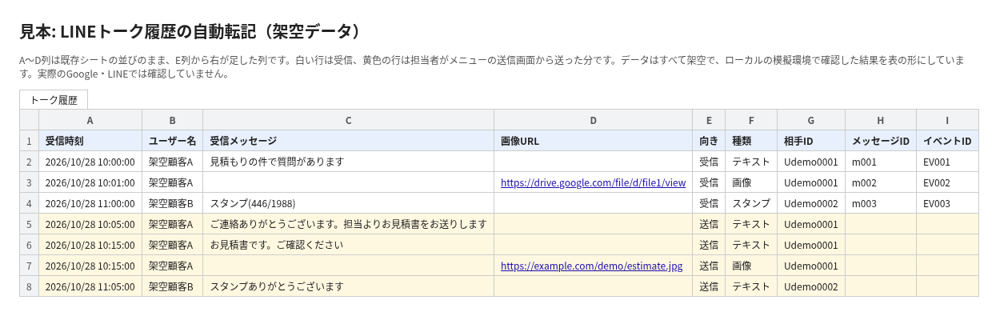
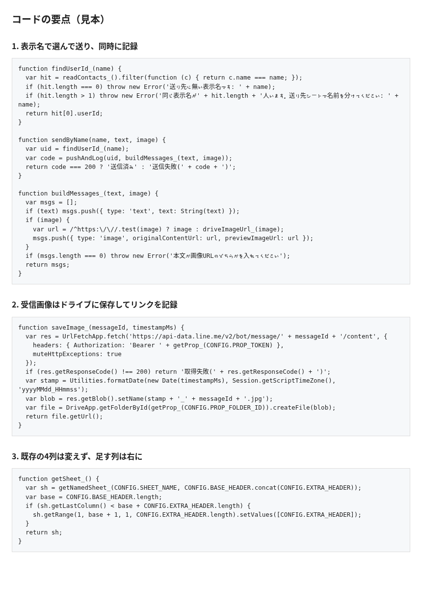
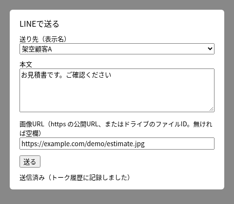

# gas-line-sheet-log-sample

LINE公式アカウントの1対1トーク（受信・送信、画像を含む）をスプレッドシートに残す、トーク対応の担当者向けの Google Apps Script の見本です。

**効果：** 管理画面を1件ずつ開いて確かめていた送信履歴が、シートから送ると同時にトーク履歴へ自動で残るようになります。

登場するお店・人物・メッセージはすべて架空です。

## 課題
LINE公式アカウントのトークを、受信はシートに残せていても、担当者が管理画面から手で送った分は記録に残りませんでした。
誰に何を送ったかを後から確かめるには、管理画面を1件ずつ開く必要がありました。

## 仕組み
1. Webhookで受けたメッセージを「トーク履歴」シートに1行ずつ書く（LINEの再送は二重に書かない）
2. 受信画像はドライブに保存し、URLを書く
3. 担当者はメニュー「LINE送信」の送信画面か「送信」シートから、表示名で相手を選んで送る
4. 送ると同時に「送信」行としてトーク履歴に書く。失敗したときは「送信失敗(コード)」と書く
5. 同じ表示名が2人いるときは送らずに知らせる

## 最初に知っておくこと
LINE Official Account Managerのチャット画面から手で送った分は、Messaging APIの外にあるため自動では記録できません。この見本では、送る場所をシートか送信画面に移す形にしています（くわしくは docs/MEMO_送信分の取り方.md）。

## 画面
画像はローカルの模擬環境（Google・LINEのモック）で出したもので、本物のアカウントの画面ではありません。

## 設置の手順
使い方.md にまとめています。画像の表示は、本番の前にLINEの実機で確かめてください。

## ファイル
| ファイル | 役割 |
|---|---|
| src/Code.gs | 受信・送信・記録・メニュー |
| src/Dialog.html | 送信画面 |
| 使い方.md | 担当者向けの手引き |
| sample_data/ | 架空のWebhookデータと、テストで書かれたシートの結果 |
| docs/ | 画面の画像・PDF・送信分の取り方メモ |
| test/ | Node.js で走らせるテスト（22件） |
| tools/render.js | 画像とPDFを作り直す |

## 作りの工夫
- テスト：`npm test`（Google と LINE のサービスを偽物に置き換えて Node.js で動かします。実際の Apps Script・LINE では動かしていません）
- 列：既存の4列は動かさず、向き・種類・相手ID・メッセージID・イベントIDを5列目から右に足す
- 二重記録の防ぎ方：イベントIDで再送を見分ける
- トークンなどはスクリプトプロパティに置き、コードには書かない

## 注意
- 架空のデータで作った見本です。実際の運用前に、自分の環境で動きを確かめてください
- 画像を送るには https の公開URLが要ります。ドライブの共有の範囲は運用に合わせて決めてください

## 作った人
Reypage｜GAS業務自動化
前の会社（プライム上場グループ）の営業組織で約3.5年、社内の業務を自動にするGASを作ってきました。約2,700人が実際に使った仕組みを設計し、利用者アンケートでの回答では1人1日約1〜2時間の事務作業が減ったとのことでした。

## ライセンス
MIT（LICENSE を参照）

## In English

A Google Apps Script sample that logs one-to-one LINE Official Account chats (received and sent messages, including images) into a spreadsheet. All data is fictional.
Incoming messages arrive by webhook and are added as rows. Staff send messages from a sheet menu or a small send dialog, choosing the recipient by display name, and each sent message is logged at the same time.
The existing four columns (received time, user name, message, image URL) stay in place. New columns are added from column E.
How to try it:
1. Create a new spreadsheet and open Apps Script from Extensions.
2. Paste `src/Code.gs` and `src/Dialog.html`, then set the script properties `LINE_CHANNEL_ACCESS_TOKEN`, `SHEET_ID` and `IMAGE_FOLDER_ID`.
3. Deploy as a web app and set its URL as the webhook URL in LINE Developers.
4. Local tests with mocked Google and LINE services: `npm test`. Not yet run in a real Apps Script project or with a real LINE account.
